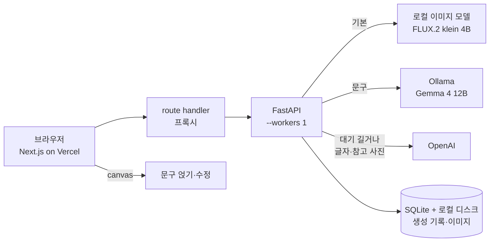

# Just Make It — AI 광고 이미지 생성 서비스 *(진행 중)*

> 2026.10.15 – 진행 중 · 3인 팀 · 코드: [just-make-it](https://github.com/sprint-ai-12-4team/just-make-it)
>
> **팀 구성** 안찬형(모델) · 장한빈(서빙) · 최중열(PM + 서비스 개발)
> **내 범위** 제품 스펙·API 명세, 모델 선정과 VRAM 배치안, GitHub Actions 배포, 서비스 DB·저장소, 프론트엔드. 팀 커밋 101개 중 40개 (10/23 기준)

<!-- TODO: 데모 영상 (촬영 예정) -->

## 문제

소상공인이 상품 사진과 몇 줄 설명만 넣으면 광고 이미지와 문구를 받는다. 운영 조건이 빡빡했다.

- GPU VM 한 대: GCP g2-standard-4, **L4 VRAM 24GB · 시스템 RAM 16GB**
- OpenAI 예산 $30
- 상업 이용 가능한 라이선스만

그래서 평소 요청은 로컬 모델로 처리해 비용을 0 에 가깝게 두고, 대기열이 길거나 로컬 모델이 못 하는 요청(한글 글자, 참고 사진)만 OpenAI 로 넘기는 구조를 잡았다.

## 구조

- RAM 16GB 를 지키려고 워커는 하나로 고정했다
- 이미지는 글자 없이 생성하고, 문구는 브라우저 canvas 로 얹는다. 로컬 모델이 한글을 제대로 못 그려서 내린 결정이고, 덕분에 사용자가 결과물의 글자를 바로 고칠 수 있다

## 모델 선정과 VRAM 배치

24GB 안에 무엇을 동시에 올릴지 표로 계산했다 (`docs/product/model_selection.md`).

| 조합 | 구성 | 합계 (+ 활성 3GB) |
|---|---|---|
| ① 이미지 2종 | klein 4B + Z-Image-Turbo | 약 22GB |
| ② 이미지 + 텍스트 | Z-Image-Turbo + Gemma 4 12B | 약 20.5GB |
| ③ 경량 3종 | klein 4B + SDXL Lightning + Gemma 4 E4B | 약 23GB |

라이선스로 먼저 걸렀다. 비상업 라이선스 모델과 한국에서 사용이 금지된 모델을 뺐다. 상주하지 않는 모델은 UI 에서 숨겼다. RAM 16GB 에서 디스크로 다시 올리면 수십 초가 걸려서다.

ComfyUI 대신 FastAPI + diffusers 를 유지했다. ComfyUI 는 모델을 RAM 으로 자동으로 내려 두는데, 16GB 에서는 스왑이 폭주할 위험이 있었다.

모델 담당이 넣은 생성 직후 VRAM 캐시 비우기와 호출 제한 시간을 서비스 브랜치에 합쳐 OOM 을 피했다.

## 배포

GitHub Actions 에서 VM 으로 SSH 접속해 `docker compose up -d --build` 한다. main·dev 브랜치를 각각 배포한다.

- Actions 에서 dubious ownership 에러 → safe.directory 지정
- `refs/heads/dev` 에서 브랜치명을 못 뽑던 버그 수정
- 빌드 전 Docker 빌드 캐시를 지워 VM 의 OOM 을 막음
- CD 빌드가 10분쯤에서 멈추던 문제 → dev 에서 해결

<!-- TODO: 10분 멈춤의 원인과 해결 방법 한 단락 -->

## 서비스 백엔드

- SQLite 에 생성 기록과 상세페이지를 저장하고, 이미지는 VM 디스크에 두고 영구 URL 을 준다. 처음엔 GCS 를 계획했다가 VM 로컬로 바꿨다
- 서버가 재시작되면 처리 중이던 작업을 정리한다
- 이미지 프록시, 캐시 헤더, 업로드 사진 축소

## 회고 *(진행 중이라 계속 갱신)*

- VM 위에서 직접 빌드하니 빌드가 서비스와 메모리를 다퉜다. 다음엔 이미지를 Actions 에서 빌드해 레지스트리에 올리고 VM 은 받기만 하게 하겠다
- 우회 기준을 "대기 건수" 가 아니라 "예상 대기 시간 합계 20초" 로 잡았다. 실제 트래픽에서 언제 발동하는지는 아직 재지 못했다
