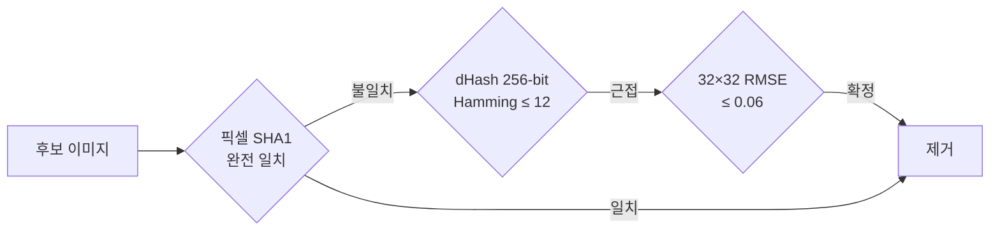
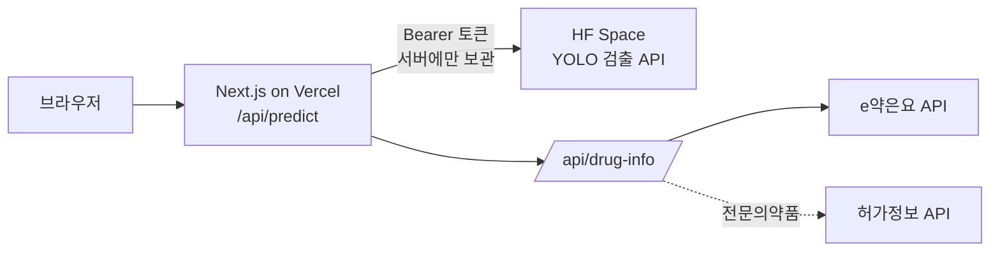

# 헬스잇 경구약제 검출 — 알약 사진 객체 검출

> 2026.06.26 – 07.14 · 5인 팀 · Kaggle 지표 mAP@[0.75:0.95]
> 코드: [project1-3team](https://github.com/taemin050-sys/project1-3team) (`beamsearch/CJY/`) · FE: [medication-detect-fe](https://github.com/joelchoi85/medication-detect-fe)
>
> **팀 구성** 이태민(PM) · 이형기(Model) · 장한빈(Experiment) · 최중열(Experiment → 서빙/배포) · 홍우석(Data)
> **내 범위** 누수 감사와 분할, 실험·HPO, 실사진 평가와 합성 데이터, 검출 API·웹앱 배포

<!-- TODO: 앱 스크린샷 -->

## 문제

사진 한 장에서 알약 최대 4개의 종류와 위치를 찾고, 그 결과를 실제 약 정보로 바꿔 보여준다.

## 너무 좋은 점수를 의심했다

Kaggle 데이터만으로 0.842 였는데, AIHub 데이터를 섞자 0.989 가 나왔다. 15%p 는 너무 컸다. 두 가지를 의심했다.

1. AIHub 에 대회 테스트셋과 같은 사진이 있다
2. train/val 분할이 새서 검증 점수만 부풀었다

### 테스트셋 대비 감사

AIHub 에서 근접중복 6장을 찾아 뺐다. 1번 의심은 대부분 아니었다.

### 장면 단위 분할

진짜 원인은 2번이었다. 같은 트레이에서 알약 하나만 바꿔 찍은 사진이 많았고, 조합 코드는 달라도 사진은 거의 같았다. 이런 쌍이 val 의 약 30% 였다.

지각해시로 비슷한 사진을 잇고 union-find 로 그룹을 합친 다음, 그룹 단위로 나눴다. 분할 뒤 근접중복 0% 를 확인하는 셀을 노트북에 넣어 누가 돌려도 다시 검사하게 했다.

| | val mAP@75:95 |
|---|---|
| 그룹 분할 전 | 0.9895 |
| 그룹 분할 후 | 0.9845 |

점수가 내려간 게 성과다. 이후 비교는 전부 이 분할 위에서 했다. 팀원이 파이프라인 없이 쓰도록 누수 제거 데이터셋을 zip 으로 내보냈다.

## 실험

- **모델 비교**: YOLO11n · SSD300 · Faster R-CNN · RetinaNet · FCOS · RF-DETR. Faster R-CNN 이 NaN 으로 발산한 원인을 쫓다가 category_id 가 데이터 출처마다 다르게 매겨진 걸 찾아 통일했다
- **5-Fold (그룹 기준)**: 평균 0.967, 표준편차 약 0.004. 분산이 작아 이후는 홀드아웃으로 비용을 줄였다
- **Optuna HPO**: 8 epoch 로 순위만 보고, best 설정은 60 epoch 로 새로 학습했다. 짧은 학습 점수는 최종 성능으로 쓰지 않았다. YOLO11s **0.9944**
- 실험마다 `config.yaml` + `metrics.json` 을 남겨 비교 코드를 재사용했다

## 검증 0.99, 실사진 0.08

검증 점수가 0.99 여도 폰으로 찍은 사진에서 통하는지는 다른 문제다. 실배경에 알약이 겹친 사진을 직접 찍어 평가셋 R0(78장, 392박스)을 만들었다.

| 학습 데이터 | R0 recall (IoU ≥ 0.5) |
|---|---|
| 스튜디오 데이터만 | **0.077** |
| + 실사진 SAM 자동 라벨 3,004장 | 0.107 |
| + 한국 약 SAM 컷아웃 겹침 합성, 절차적 배경 | **0.181** |
| 같은 합성, 배경만 실사진으로 | 0.158 |

배경은 진짜 같음보다 다양성이 중요했다. 그래도 0.18 근처가 합성의 한계로 보였고, 다음 단계는 실제 사진 수백 장을 모아 라벨링하는 것으로 정리했다.

## 서빙

- 검출 API 가 YOLO 원본 출력을 그대로 돌려주며 늘 500 이 나던 상태를 고쳐, 박스 변환·NMS·클래스명 매핑을 넣고 고정 JSON 으로 응답하게 했다
- 프록시 라우트에서 업로드 형식과 10MB 를 검사하고, HF Space 가 절전에서 깨어나는 시간을 고려해 55초 타임아웃과 원인별 로그를 뒀다
- 검출 클래스를 공공데이터 API 와 이어 약 정보 카드로 보여준다. e약은요에는 전문의약품이 아예 없다는 걸 실측으로 확인하고, 허가정보 API 로 "왜 안 나오는지" 안내했다

## 회고

- 실사진 평가셋을 처음부터 만들었어야 했다. 검증셋이 배포 환경을 대표하지 않으면 0.99 는 스튜디오 시험 만점일 뿐이다
- 누수 감사는 한 번 확인하고 끝낼 게 아니라 파이프라인 단계로 고정해야 한다
- 학습이 이상하게 느리면 로그 맨 위의 device 부터 본다. 맥에서 device 를 안 써서 CPU 로 57시간짜리 학습을 돌릴 뻔했다
