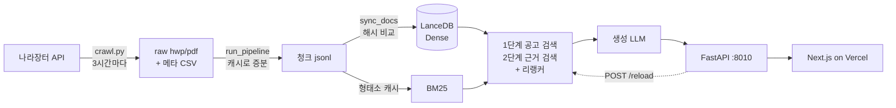

# RFP RAG System — 공공입찰 제안요청서 Q&A

> 2026.08.25 – 09.11 · 4인 팀 · 코드: [rfp-rag-system](https://github.com/codeit-ai12-project2-team4/rfp-rag-system)
>
> **팀 구성** 권혁상(Data) · 안찬형(PM) · 최민식(Generation) · 최중열(Retrieval)
> **내 범위** 검색 전체, 서빙 운영(모델 서버·API·크론), 평가 체계. 팀 커밋 301개 중 234개

<!-- TODO: 데모 영상 (가지고 있는 녹화본) -->

## 문제

공공입찰 컨설턴트는 하루 수백 건 올라오는 RFP 에서 참가자격·배점·과업기간을 찾아 읽는다. 한 건이 수십~수백 쪽이고 핵심 정보는 문서마다 다른 표 안에 있다. 이걸 질문 한 줄로 근거와 함께 찾게 만드는 게 목표였다.

공고는 매일 늘어나고, 팀 API 예산은 $20 였다. 그래서 임베딩·리랭커는 **자체 GPU 서빙**으로 돌리고(OpenAI 임베딩·Cohere 리랭커와도 비교했다), 갱신은 **사람 손 없이** 돌아가게 하는 걸 목표로 잡았다.

## 구조

GPU VM 한 대(L4 24GB)에 모델 서버 넷을 올렸다.

| 서버 | 모델 | VRAM |
|---|---|---|
| 임베딩 (TEI) | snowflake-arctic-embed-l-v2.0-ko | 약 1.3GB |
| 리랭커 (TEI) | bge-reranker-v2-m3-ko | 약 1.3GB |
| SPLADE (TEI) | PIXIE-Splade-v1.5 | 약 1GB |
| 생성 (SGLang) | Qwen2.5-3B / EXAONE-3.5-2.4B / 8B 2종 중 하나 | 4~19GB |

TEI 셋이 4GB 를 상주로 쓰고 생성 모델에 20GB 가 남는다. 8B 하나면 꽉 차서, 생성 모델은 **상주 대신 교체**했다. UI 에서 모델을 고르면 API 가 컨테이너를 다시 만든다(30초~2분). launch 가 실패하면 `restart: unless-stopped` 때문에 조용히 무한 재시도하므로, 재시작 횟수가 0 을 넘는 순간 로그 꼬리를 붙여 바로 실패시켰다.

## 운영 자동화

### 증분 색인

처음엔 공고가 바뀔 때마다 전체를 다시 임베딩했다. FAISS 는 부분 삭제와 필터가 안 돼서 다른 방법이 없었다. LanceDB 로 옮기고 청크마다 `doc_id + 본문 + 메타데이터` 해시를 남겨, 새 공고만 넣고 바뀐 공고는 지웠다 다시 넣고 사라진 공고는 지웠다.

메타데이터를 해시에 넣은 건 버그를 겪고 나서다. 본문이 같으면 제목이 새로 채워져도 그냥 지나갔다.

### 기동 185초 → 1.9초

새 청크를 반영하려면 API 를 재시작해야 했고, 재시작에 3분이 걸렸다. 재 보니 **형태소 분석이 184.4초, 색인 구축이 0.8초**였다. 색인은 매번 새로 만들어도 되고 비싼 건 분석이었다.

형태소 분석 결과를 본문 해시로 캐시했다. 청크 이름이 아니라 본문 해시로 찾으니 코퍼스 버전이 바뀌어도 그대로 맞는다. 기동이 1.9초가 됐고 RAM 도 950MB → 487MB 로 줄었다. 그러자 재시작 대신 `POST /reload` 로 무중단 반영이 가능해졌고, 밤에만 돌던 갱신을 3시간마다로 늘렸다.

### 조용한 실패 막기

파이프라인에서 가장 많이 고친 건 에러 없이 틀리는 경우였다.

- 크롤러가 hwpx 를 받는데 파이프라인이 그냥 건너뛰고 있었다
- 맥에서 만든 파일명(NFD)과 리눅스 쪽(NFC)이 달라 평가 세트 업로드가 통째로 거절됐다
- CSV 병합이 실패해도 진행돼서, 병합률 90% 아래면 멈추게 했다
- 인덱스에 청크 지문과 모델명을 남겨, 다른 전처리본이나 다른 모델로 만든 인덱스를 기동 시점에 잡는다

## 평가

기준 세트는 **`eval_qa_160` (160문항)**. 배점·요구사항·의역·없음 네 유형으로 나눴다. 청크가 바뀌면 평가 세트를 자동으로 다시 만든다.

### 평균 말고 부호를 센다

설정 A 와 B 의 MRR 이 0.008 차이 났다. 같은 설정을 두 번 돌리면 ±0.015 흔들렸다. 평균으로는 판정할 수 없어서, 두 실행을 문항 단위로 짝지어 어느 쪽이 이겼는지 부호를 세는 비교 도구를 만들었다. 이후 결정은 전부 이 도구를 거쳤다.

### 채점 비용

인용 표시·인용 범위·숫자 근거는 규칙으로 채점하고, LLM 심판은 충실성 하나에만 썼다. 합본 191문항 한 바퀴가 $1.34. 팀 예산 $20 안에서 실험을 여러 번 돌릴 수 있었다.

## 의사결정

| 결정 | 가설 | 측정 | 결과 |
|---|---|---|---|
| 1단계 pool 200 → 20 | 후보를 많이 뽑을수록 좋다 | pool 200/100/50/30/20 스윕 (합본 177문항) | Hybrid MRR 0.478 → 0.576. 반대였다 |
| parent-child 청킹 철회 | 작은 자식 청크가 정밀하다 | 부모 1200 / 자식 300 | 배점 0.833 → 0.789, 인덱스 4.8배. 답이 표 안에 있어서 300자가 표 헤더와 값을 갈랐다 |
| 청크 머리말 [사업명] | 공고 구분 신호가 필요하다 | Dense 단독 / + 리랭커 | 배점 0.175 → 0.575 → 0.950 |
| 용어추가 되살림 | 붙인 낱말 84% 가 근거에 없으니 잡음이다 | 잡음 말고 이득을 재 봄 | 의역 적중률 0.943 → 0.962. 처음엔 한쪽만 재고 뺐다 |
| FAISS → LanceDB | 부분 삭제가 필요하다 | — | 증분 색인 가능 |

## 회고

- 평가 세트가 조용히 바뀌어 다른 시험지로 비교한 적이 있다. 평가 결과에 세트 지문을 같이 남겼어야 했다. 다시 한다면 MLflow 로 실험마다 데이터·설정·지표를 같이 묶겠다
- cron 은 실패를 알려주지 않는다. `/health` 에 마지막 갱신 결과를 노출하는 걸로 버텼지만, 스케줄러와 알림이 있어야 했다
- 원문 NDA 때문에 팀원에게 데이터를 못 넘겼다. 검색 결과(`contexts_*.jsonl`)만 넘기면 GPU 없이 채점할 수 있게 경로를 나눈 게 협업을 살렸다
